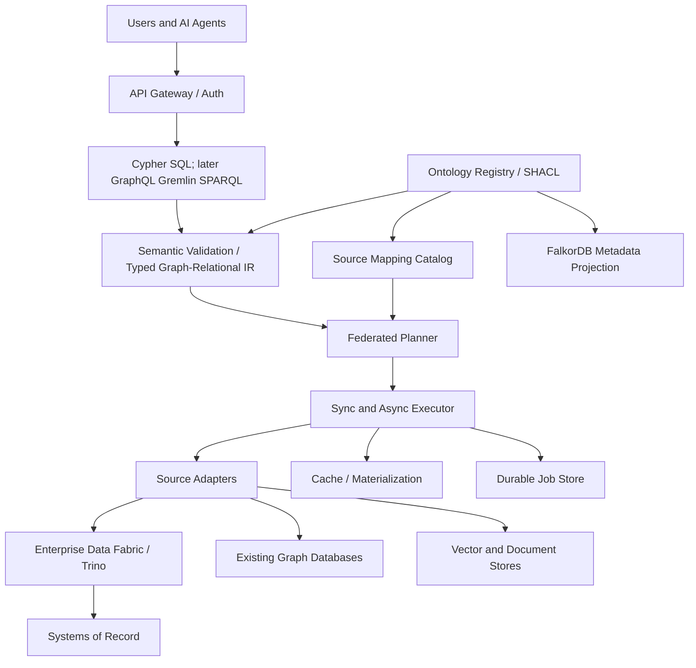
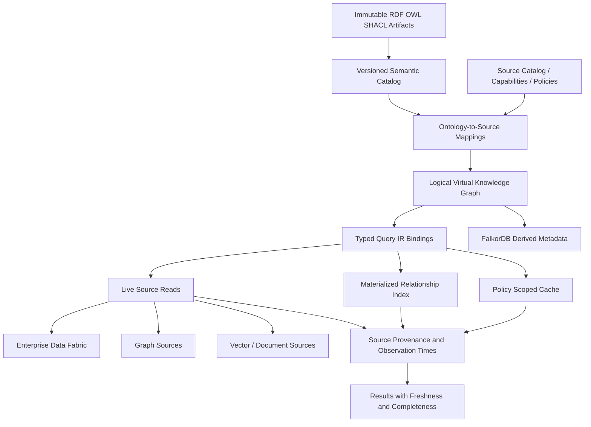

# Federated Knowledge Platform — Architecture

## Application Architecture

The ontology registry is the control plane. Query gateway, planner and execution are the data plane. Trino owns structured federation; do not duplicate its connectors. FalkorDB stores a rebuildable metadata projection, not authoritative RDF/OWL semantics.

## Data Architecture

Authoritative ontology artifacts remain immutable. PostgreSQL holds registry metadata and versioned mappings. Source systems retain authoritative transactional records. Cache and materialized edges have explicit refresh, lineage and authorization policies. Do not claim globally consistent snapshots across unrelated sources.

## Decisions
1. RDF/OWL authoritative; FalkorDB metadata is derived.
2. Language-independent typed graph-relational IR.
3. Narrow bounded Cypher and SQL subset before other languages.
4. Live, cached, materialized and async execution modes.
5. Explicit unsupported-feature errors and partial-result states.
6. OWL reasoning added after core correctness and versioning.

## Risks
Cross-source fanout, entity identity collisions, ontology incompatibility, inconsistent snapshots, policy leaks via joins and cache, and distributed failure. Apply bounded traversal, batching, identity namespaces, pinned versions, source timestamps, policy-aware caches and resource budgets.
