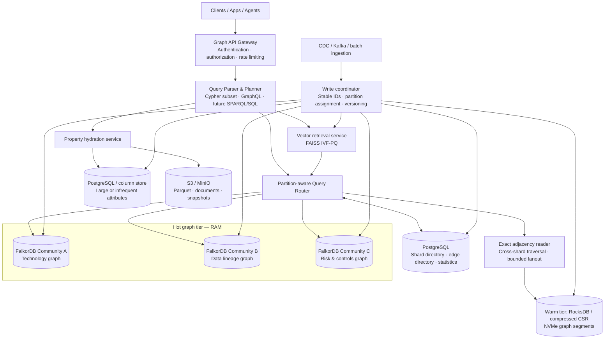
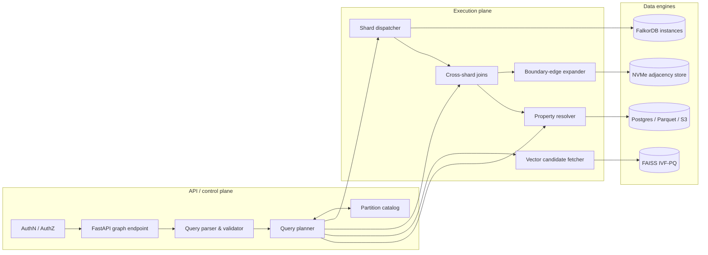
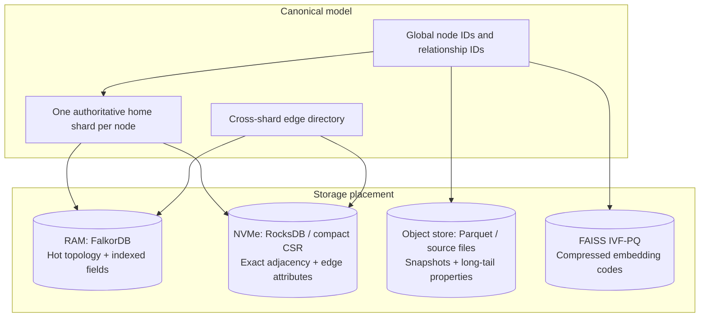
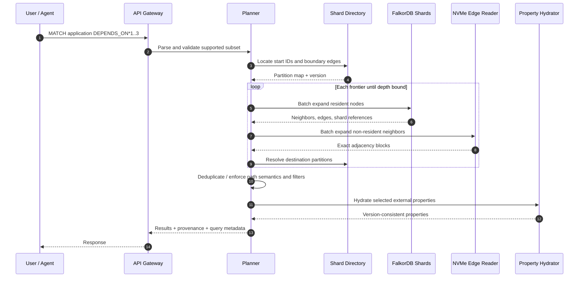
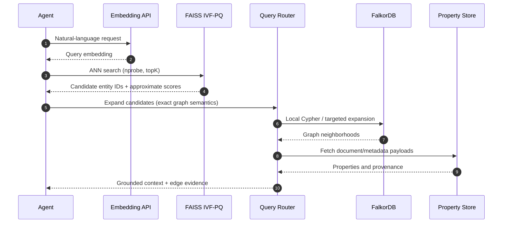
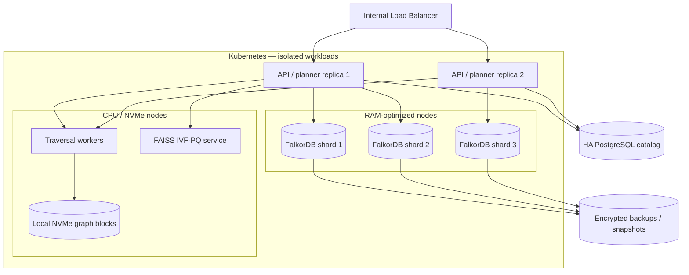
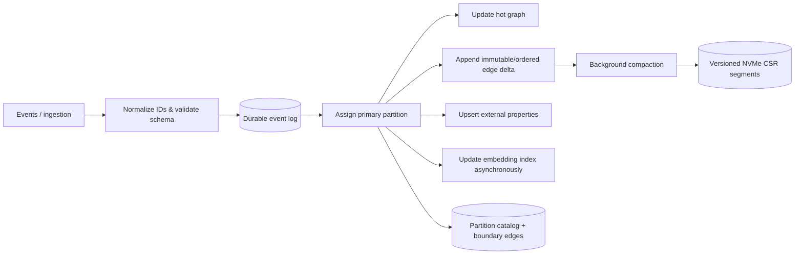
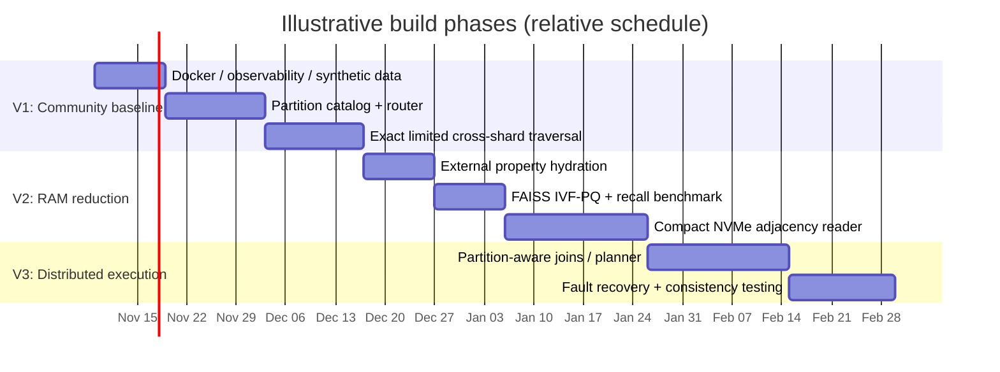

# RAM\-Efficient Distributed Graph Platform with FalkorDB Community

**Architecture proposal · 2026\-11\-03**
**Goal:** Build a cost\-aware enterprise graph platform using independent FalkorDB Community instances, external compressed storage, and IVF\-PQ for embedding retrieval—without assuming native distributed Cypher or disk\-backed paging exists in FalkorDB\.

> **Important:** This is a *target architecture*, not a statement of native FalkorDB capabilities. The query gateway, shard directory, distributed traversal, hot/warm migration, and cross-shard consistency controls are custom components. IVF-PQ compresses **vectors**, not graph relationships. Exact graph queries must not silently drop edges or partitions.

## 1\. High\-level architecture



**Principle:** FalkorDB stores and evaluates the *hot* subgraphs\. The custom routing layer knows where an entity resides and can expand across shards\. The vector index returns **candidate IDs** only; exact graph operators handle relationship semantics\.

## 2\. Application architecture



**Initial supported operations:** indexed entity lookup, local Cypher queries, fixed\-hop relationship expansion, cross\-shard fan\-out, and vector\-search → exact\-graph\-retrieval\. Don’t claim arbitrary distributed Cypher support until joins, path semantics, variable\-length expansion, ordering, pagination, and transaction semantics have been implemented and tested\.

## 3\. Data architecture and placement



|Data class                                 |Primary location                                 |Key invariant                                                 |
|-------------------------------------------|-------------------------------------------------|--------------------------------------------------------------|
|Hot nodes, hot edges, indexed query fields |FalkorDB RAM                                     |Queries see an explicitly defined consistent version          |
|Cold/warm adjacency and edge attributes    |NVMe, compact CSR / RocksDB                      |**Lossless** topology; no missing cross-partition edges       |
|Long descriptions, JSON, documents, history|Postgres / Parquet / S3                          |Stable global IDs and versioned references                    |
|Embeddings                                 |FAISS IVF-PQ; optional full vectors for reranking|ANN recall is measured; approximate results clearly identified|
|Shard membership and boundary-edge metadata|PostgreSQL catalog                               |Strongly controlled updates and versioning                    |

### Mapping IVF\-PQ inspiration

|IVF-PQ concept                      |Graph architecture analogue                     |Exact or approximate?                          |
|------------------------------------|------------------------------------------------|-----------------------------------------------|
|Inverted lists / coarse partitioning|Graph partition directory                       |Exact routing for graph queries                |
|`nprobe`                            |Number of vector clusters searched              |Approximate retrieval only                     |
|PQ codes                            |Compressed embedding codes                      |Lossy vector approximation                     |
|Vector reranking                    |Optional full-vector reranking + graph lookup   |Exact graph, optionally exact similarity rerank|
|Compact storage                     |Sorted neighbor IDs, delta + varint / bitpacking|Lossless graph compression                     |

## 4\. Exact graph query sequence



**Correctness requirements:** respect direction, relationship type, labels, path uniqueness rules, deduplication, predicate ordering, access control, snapshot consistency, and exhaustive boundary\-edge discovery\. A result `LIMIT` doesn’t bound intermediate traversal work\.

## 5\. Hybrid semantic retrieval sequence



**Boundary:** ANN determines *which candidate entities to inspect*, not whether an edge exists\. Recall@K should be benchmarked against a flat/full\-precision index\.

## 6\. Deployment topology &#40;self\-managed Community&#41;



**Operational note:** Three independent Community instances are *not* a native distributed graph cluster\. Kubernetes restarts don’t by themselves guarantee HA or recoverability\. Design persistence, backup/restore, read replicas where validated, failover, request retry semantics, and consistency explicitly\. Use `noeviction` for graph data rather than Redis key eviction as a pretend graph page cache\. Pin image versions and test exact settings against the selected release\. Review FalkorDB licensing &#40;SSPL&#41; with legal counsel if distributing or offering a hosted service\.

## 7\. Write path and consistency model



**Recommended V1 semantics:** identify a primary owner for each entity and a single authoritative write path\. Use an idempotent event log, monotonically increasing versions, and explicit eventual consistency for ANN and external property projections\. For exact multi\-shard reads, define and test a consistent snapshot or a documented weaker consistency contract\. Never silently promise atomic distributed transactions\.

## 8\. Development plan



*Dates are placeholders for planning, not commitments or effort estimates\.*

## 9\. Proof\-of\-concept experiments

1. **Baseline:** 10M\-node synthetic graph, representative skewed degree distribution, and a mix of single\-hop, 3\-hop, lineage, dependency, and vector\-to\-graph workloads\. Measure one FalkorDB instance with full hot properties\.
2. **Property offloading:** Move large/infrequently filtered fields outside FalkorDB; compare resident memory, query latency, extra I/O, and functional equivalence\.
3. **Partitioning:** Use three independent FalkorDB instances and a catalog\. Verify cross\-partition results against the unpartitioned baseline\.
4. **IVF\-PQ:** Index embeddings separately\. Benchmark payload footprint, search p95/p99, recall@K, `nprobe`, and reranking overhead\.
5. **Warm adjacency:** Test compressed CSR / RocksDB traversal at controlled hot\-set percentages, including degree\-skewed supernodes and cross\-shard paths\.
6. **Resilience:** Kill a shard, restart query workers, replay ingestion, restore backups, and confirm recovery point and consistency guarantees\.

### Suggested evaluation dashboard

|KPI                        |Definition                                            |Goal                                |
|---------------------------|------------------------------------------------------|------------------------------------|
|RAM per logical node/edge  |Aggregate hot-tier resident bytes / logical graph size|Reduce versus baseline              |
|Exact-result equality      |Canonicalized query outputs vs single-graph baseline  |**100%** for supported exact queries|
|p95 / p99 traversal latency|By hop count, fanout, and cache state                 |Within workload-defined SLO         |
|NVMe bytes per query       |Storage read volume + decompression CPU               |Lower with warm-cache locality      |
|ANN recall@K               |IVF-PQ vs exact vector search                         |Match product-specific target       |
|Cost per 1M queries        |Compute, RAM, NVMe, S3, replication, operations       |Lower at equal SLO                  |
|Recovery                   |RPO/RTO, repeated crash / replay tests                |Meet enterprise policy              |

## 10\. Suggested repository structure

```text
falkordb-tiered-graph/
├── docs/
│   ├── architecture.md
│   ├── consistency-contract.md
│   ├── partitioning.md
│   └── benchmark-plan.md
├── services/
│   ├── api-gateway/
│   ├── query-planner/
│   ├── partition-catalog/
│   ├── adjacency-reader/
│   ├── property-hydrator/
│   ├── vector-search/
│   └── ingestion/
├── benchmarks/
│   ├── synthetic-generator/
│   ├── workloads/
│   └── correctness-oracle/
├── deploy/
│   ├── docker-compose/
│   └── kubernetes/
└── tests/
    ├── cross-shard/
    ├── consistency/
    └── recovery/
```

## 11\. Non\-goals and guardrails

- **No assumption of native FalkorDB disk paging:** cold/warm graph storage is an external execution capability\.
- **No arbitrary Cypher federation in V1:** support a small, tested query subset first\.
- **No lossy edge compression:** relationship topology must remain exact\.
- **No Redis key eviction as fine\-grained tiering:** do not risk evicting whole graph keys\.
- **No ****`nprobe`**** pruning for exact traversal:** use IVF\-PQ only for approximate candidate retrieval\.
- **No assumed native cross\-shard transactions:** expose actual consistency semantics\.
- **No cost claim from theoretical PQ ratio:** report end\-to\-end resident memory and cloud spend\.

## 12\. References to verify against your pinned release

- [FalkorDB GitHub repository](https://github.com/FalkorDB/FalkorDB)
- [FalkorDB documentation](https://docs.falkordb.com/)
- [FAISS index documentation](https://github.com/facebookresearch/faiss/wiki/Faiss-indexes)
- [GraphBLAS](https://graphblas.org/)

---

**Recommended first milestone:** Run three independently deployed Community instances and a PostgreSQL partition directory, support exact 1–3\-hop cross\-shard traversal from stable global IDs, and demonstrate correctness against an unpartitioned baseline before adding IVF\-PQ or NVMe tiering\.
